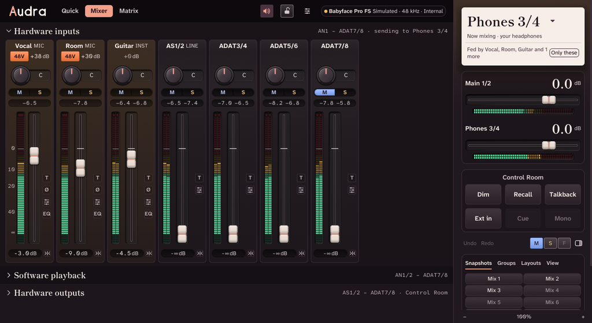
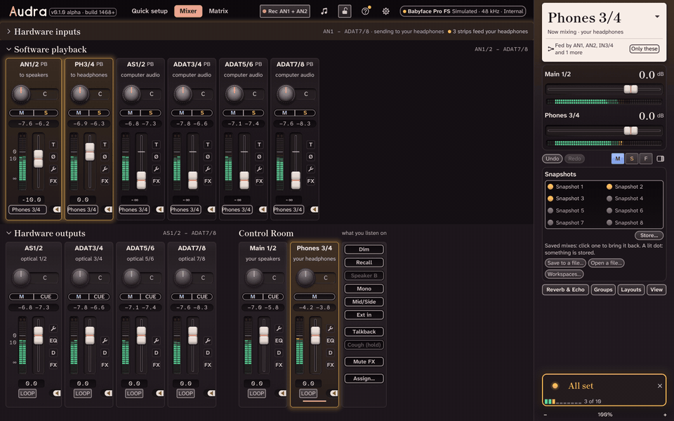
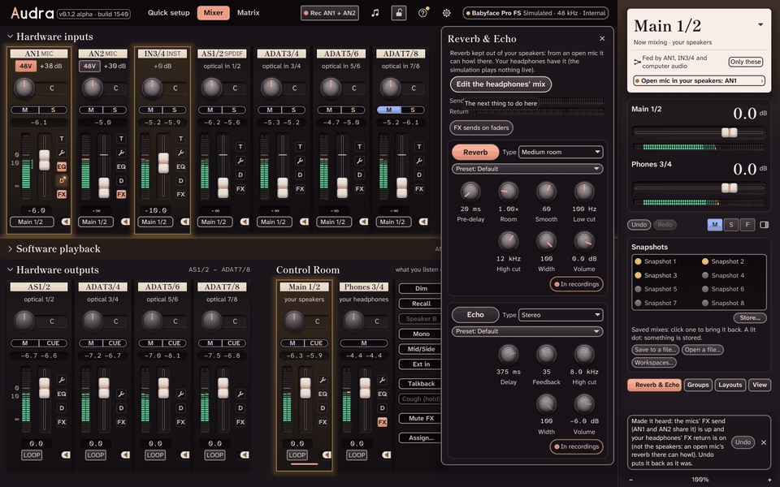
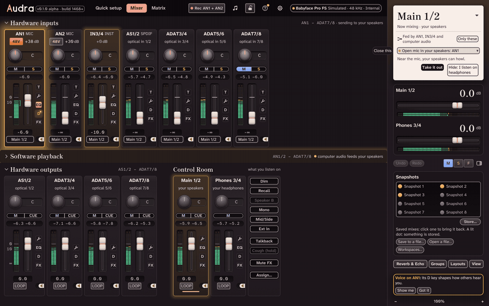
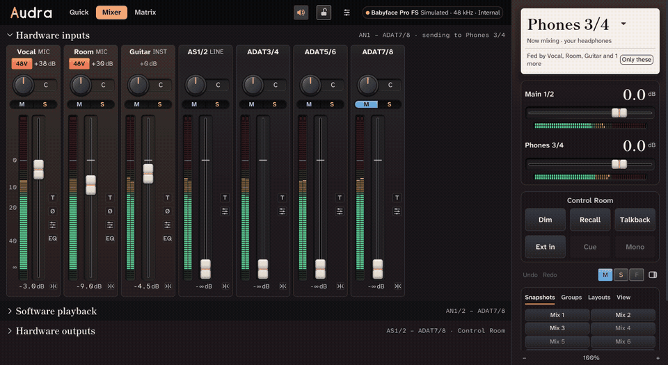

# Audra

A hardware mixer for the **RME Babyface Pro FS** on Linux. Audra works the way the Windows mixer does (input, playback and output rows, one submix at a time, a Control Room and a routing matrix), in a look of its own. It runs with the unit in its regular USB mode (PC mode, `2a39:3fc0`).

Audra is built on two community projects by ismail-bahloul: the [`snd-usb-babyface-pro`](https://github.com/ismail-bahloul/babyface-pro-linux) kernel driver and [TuxMix](https://github.com/ismail-bahloul/TuxMix). Its GUI started as TuxMix's.

> Not affiliated with RME. *TotalMix*, *TotalMix FX*, *Babyface Pro* and *Babyface Pro FS* are trademarks of RME Intelligent Audio Solutions.



*Audra's Mixer, editing the headphones' mix. Every picture here is Audra's simulated device with a small studio set up.*

**▶ [Watch the one-minute tour on YouTube](https://youtu.be/phW8Z627bA8)**

## Early preview

Audra is an **early preview** for people willing to test. The driver and the basic mixer have run on one Babyface Pro FS, but most of what's listed below has only been checked in the simulation (`--mock`, no unit needed) and **has not yet been tried on a real Babyface**.

- **Start with your speakers and headphones turned down.** Audra routes microphones, often with 48V phantom power on. It warns about an open mic in the speakers and keeps its reverb out of them, but a setting you didn't expect can still feed back.
- **It needs its own kernel driver** (below). Reverb and Echo need the driver's newer FX channels; an older driver can't play them back (Audra says so).
- **Linux only**, built and run on Pop!_OS 24.04. Other distributions should work but haven't been tried.
- **Found something?** Use the issue forms: they ask what's needed to reproduce it. Anything that sounded unsafe (feedback, a loud burst) goes first. To send a change, see [CONTRIBUTING.md](CONTRIBUTING.md).

## Get started

**1. Look around first, no unit needed.** On Pop!_OS or Ubuntu, with [Rust](https://rustup.rs):

```sh
sudo apt install build-essential pkg-config libasound2-dev
git clone https://github.com/Vyeche/Audra.git audra && cd audra
AUDRA_MOCK_DEMO=1 cargo run --release -p audra -- --mock
```

The simulation shows a small studio (a mic on AN1, a second on AN2, a guitar on IN3/4). Nothing you do in it reaches any hardware.

**2. Install it for your Babyface Pro FS.** You need Linux 6.12 or newer for the driver (`uname -r`; on Ubuntu 24.04, install `linux-generic-hwe-24.04` and reboot). Put the interface in PC mode (at power-on the meters show nothing; if they show **CC**, hold SELECT and DIM while plugging in the USB cable), then build and install the two packages, Audra and its driver:

```sh
sudo apt install dkms linux-headers-$(uname -r)
packaging/build-deb.sh
sudo apt install ./target/debian/audra_*.deb ./target/debian/snd-usb-babyface-pro-dkms_*.deb
```

Replug the interface (or reboot), turn your speakers and headphones down, and open **Audra** from the app launcher.

**3. Follow Quick setup.** It opens on the first start: your mic, its level, and where you hear it, each ticked off when it's right. Then "What are you doing?" sets up a podcast or call, a headphone mix, recording or streaming in one press. After your first setup, run `sudo alsactl store BabyfacePro` once so the mix survives a replug.



The [wiki](https://github.com/Vyeche/Audra/wiki) shows each part with pictures and short animations; [docs/getting-started.md](docs/getting-started.md) has more detail, and [docs/troubleshooting.md](docs/troubleshooting.md) helps when something's off.

## A quick look

| | |
|---|---|
|  | **Reverb and Echo**, run on the computer through the unit's FX send and return. With an open mic, **Make it heard** puts the reverb in your headphones and keeps it out of the speakers. |
|  | **Safety first.** A mic with 48V on in your speakers can howl: the card at the top right says so in any view, with the one press that fixes it. |
|  | **Ten colour themes**, High contrast included, a theme that follows the time of day, and themes of your own. |

More in the [wiki's tutorials](https://github.com/Vyeche/Audra/wiki/Tutorials).

## Status

Early and personal: version 0.1.0, tested on one machine (Pop!_OS 24.04, kernel 7.2.6, one Babyface Pro FS).

**Works:**
- Quick setup, Mixer and Matrix views (the first launch opens Quick setup); one row open at a time on short windows, or two rows side by side. Quick is a guided setup in three steps: your mic (its preset and 48V), its level (a meter with a "speak here" band and the gain), and where you hear it, each ticking off when it's right. An optional fourth step, "Make your voice sound good", opens your mic's D panel with the Clear Calls preset set ("Not now" puts it away for good). A mic listens on the Phones by default; an open mic (48V on or a high gain) sent to the speakers is a warning, not a tick, since it can howl; the Now Mixing card says the same in any view, in one line that opens to "Take it out" (that one send, undoable) or "It's meant to be there" (remembered; Audra settings → App warns again). Quick's choice of where to listen is its own and doesn't change the Mixer's mix.
- Meters under the Main and Phones levels, so what you hear is always in view. The Matrix can edit a stereo pair as one or one channel at a time (Mono Mode).
- Faders, meters with peak hold, pan (a balance on a stereo pair, playback included), mute, and solo per submix (or exclusive). Levels are TotalMix's: 0 dB on a stereo source is the unit's unity and a centred mono source sits 3 dB lower on each side, up to +6 dB (driver 2026-11-09; mixes saved before then are converted when read, so they sound as they did). PFL in Live Mode. Letting go of a solo, a PFL or Cue glides back what it silenced over half a second, as Dim does. A double-click or a click on the lane that turns a level up a lot glides it there instead of jumping, and a double-click never turns up Main or the Phones; a fader-group member that would jump up more than 6 dB (near the bottom of its travel) glides there too.
- Mic setup: 48V and gain on the strip, plus PAD, link and AN1→2 in its settings, and mic presets there: a mic's gain, PAD, phase, EQ and Low Cut under a name, loaded onto a strip or a stereo pair in one go (a preset's 48V waits for your click); one can load each time Audra starts (Settings → Mixer → At start).
- 3-band EQ and low cut on AN1–4 and on the Main, Phones and AS 1/2 outputs (an output's "EQ panel" row in its Settings), with presets you can import and export. With the 2026-11-09 driver, Audra computes the filters itself, as TotalMix does, and sends them to the unit: the driver's own input EQ got the high shelf wrong and put AN1's EQ on AN2 too, so Audra keeps it off.
- Phase invert on every output (ØL and ØR on a stereo pair) and M/S processing on an output pair (mid on the left, side on the right), in the output's Settings, done on the unit as TotalMix does them (driver 2026-11-09).
- Width and M/S processing on every linked stereo input and playback pair, in its Settings under "On the unit" (AN1/2's M/S in the device card). Width is TotalMix's: +1.00 as recorded, 0 mono, −1.00 left and right swapped, written into every output the pair plays in. They stand in a "Stereo" group at the top of the panel with the pair itself, and a width off +1.00 shows on the strip as W, MONO or L⇄R.
- Strips as TotalMix's: T (Trim Gains: one fader moves a channel in every mix, with markers for the other mixes) on every input and playback strip, the wrench for its Settings, EQ, a small FX fader beside the fader where there's a send or return (AN1/2's send on AN1's strip, every output's return; an FX key where a fader is too short for it), and at its foot the routing field naming the mix its fader edits, with the ◀ key that narrows the strip beside it at the same height (folding closes the foot into the key first, then narrows). What the Linux driver doesn't open (EQ on AS 1/2 and ADAT inputs and ADAT outputs; on an older driver, sends beyond AN1/2) has no key, and the strip's Settings panel says why. A strip's Settings or EQ panel opens beside it as tall as its rows, lying over the row below, so everything in it shows at once; it scrolls only on a window too short for it, and stops above a card at the window's foot.
- Loopback.
- Control Room: Main and Phones levels, Dim, Recall, Mono, Mid/Side (a width check on Main, never kept in a snapshot), Talkback (also to other outputs), **Cough** (held, or hold C: silences what others hear while Voice runs), Listenback, External Input, Cue, Speaker B, and Assign for which outputs are Main and the Phones. The same carved keys wherever they stand: beside Main and the Phones in the Mixer, as in TotalMix, else at the head of the right-hand column.
- Copy, paste, clear and mirror a submix or a channel's mix. Reset Mix. Free routing, to edit several mixes side by side.
- Plain words: a quiet line under the outputs' and playback's names (*your speakers*, *your headphones*, *optical 1/2*, *to speakers*) at any window size without shortening a fader, and in each name's hover (inputs too: *optical in (S/PDIF)*); switchable off. Press **?**, or Help → **What's this?**, and every hint shows at once as you point.
- A map of where sound goes: **Where it goes** in a channel's Settings panel shows which speakers and headphones it is heard in and how loud; **What plays here** in an output's shows everything on it, Reverb & Echo included when they're on (and why they aren't heard, if they aren't); the placard's "Fed by …" line opens the map of the mix being edited. It opens beside the panel, as tall as it.
- PAD on is said on the strip: **AN1 PAD** where it said MIC, in the state colour, and a lit PAD chip on a folded strip. PAD off's notice says the safety net ("If it clips, Audra stops."), and the gentle rise does stop by itself if the mic clips. The open-mic warning turns into a quiet grey line once you've opened it, amber again only when that mic gets hotter.
- No sudden jumps: a snapshot, Undo or workspace that raises a level or a send by more than 6 dB slides it up (an Undo pressed while PAD off is still gliding included), and Audra that closed with Dim on comes back still dimmed, saying so, for you to bring Main up.
- Snapshots you can name and save to a file (and which can leave Main and Phones alone), groups, layouts that collapse and hide channels (they keep playing), and workspaces that hold the whole setup (30 quick slots, or a file). On a tall column the snapshots are one named list with Store under it, where TotalMix keeps them; on a shorter one they are TotalMix's row of eight keys with Store, and the column's pages open as cards beside it.
- Reverb and Echo, Audra's own, run on the computer as the unit expects (it has no effects processor of its own): ten reverb types and three echoes, each with its knobs, a send from AN1/2, a return in every output, and Mute FX in the Control Room. See [Reverb and Echo](#reverb-and-echo).
- Lock the mix from the top bar.
- Scroll markers for rows wider than the window.
- Ten colour themes (Audra, Daylight, Graphite, Slate, High contrast, Midnight, Crimson, Monokai, Nord, Solarized), one click away in the View page and in Settings → Look, a setting that fades from a day theme to a night theme by the clock, and themes of your own from simple JSON files.
- Controls that look and feel like hardware: turned knobs, metal fader caps in a lane, LED-ladder meters, joined M|S keys that show their colour before they light.
- Optional animations and UI sounds that give feedback: faders glide on a recall, controls splash when they land on 0 dB or the centre, keys warm up and cool down, and distinct sounds for kept, refused and disarmed.
- Learning as you go: the first time you use a shortcut or gesture, a small card names it ("5 of 22 found"), and doing something the slow way a few times brings one tip for the fast way. Help ticks off what you've found; Settings → App switches it off. At start the meters run a quick light test, like a desk powering on; Quick's ticks draw themselves in, its level band glows while your voice sits in it, and the Reverb key flares the moment the effect is first heard.
- Milestones for real firsts (Quick all set, your first snapshot, a mic preset, a mic in your headphones, the reverb heard, a call app hearing Voice, your first take with Rec, a take holding its reverb or echo, a Reverb/Echo preset of your own, every trick found): a card bursts with sparks of lamp light, lights the next LED on a ladder of nine, and plays three soft rising notes that climb as your wins chain. Help lists them, with how to reach the ones still ahead. The notes have their own switch, "Celebration sounds", in Settings → Look (Motion and sound).
- Ready-made setups at the top of Quick setup ("What are you doing?"): **Podcast or call** (your mic and the computer in the Phones, the mic kept out of the speakers), **Headphone mix** (the Phones play the speakers' mix), **Record** (a spare output's mix of mic and computer, looped back for your recording app) and **Stream** (both), and **My setup**: keep the mix you have now, then one press brings it back (replacing it asks first). One press, one Undo; levels glide up and 48V waits for your click; a card says what changed and why, with "Show me in the Mixer".
- **Voice and Dynamics (the D key on every input and output strip)**: on a mic it's called **Voice**; on an output, **Dynamics**. TotalMix's Dynamics panel: a compressor, an expander and Auto Level, with the curve, a dot for the level now and marks for how far it turns down. The Babyface has no dynamics in the unit (the Fireface UCX II and UFX III do), so Audra runs them on the computer: on an input, on what others hear (the processed voice goes to your apps as a virtual mic, "Audra processed mic", and to Rec; one input at a time), while you keep hearing yourself straight with no delay; on an output, on what the computer plays there (apps play to a virtual speaker such as "Audra Phones 3/4"), while your mic and instruments still reach it at once. It opens simple (presets: Clear Calls, Streamer, Podcast, Singing, Radio Voice, Drums, each with a −2 dB safety limit; a level coach; Fit to my voice; voice strength; noise removal for fans, hum and hiss, which the mic check offers only when the room is close under your voice; quiet between words; keep me even; Reset to Natural), with TotalMix's knobs under More. On outputs: Volume protection, Even out, Night. Auto-Tune for what others hear is a switch there too. The panel says how late others hear you (about 40 ms, 60 with noise removal): fine for calls, streams and computer sound, too late for your own ears. The round ON key at the top is the power for the whole path (lit solid while on; while it's off, chosen settings show a "waiting" tint), and a card under it says in words what others hear. Picking a setting starts it at once; if Voice runs on another mic, Audra asks before moving it; the simple settings sit in three groups (Your level, Your sound, During the call). The first time a mic is set up, a one-time hint on the Mixer points at its D key (Show me or Got it; none with tips off).
- **Record** (the top bar's **Rec**): one press records the input Quick setup works on (both sides of a linked pair) to a 24-bit WAV file in `~/Music/Audra`, named by date and time and never overwritten (through Voice when Voice is on; with your Reverb and Echo as you hear them, in stereo, each switchable by the **In recordings** key under it on the Reverb & Echo page); press again to stop, and the note that says where it went has an **Open folder** button. It stops by itself, keeping what it recorded, if the unit goes away or the disk is nearly full; past the WAV format's 4 GB (about four hours of two channels) a take goes on in "… part 2.wav" without a gap. RME's DURec records to a USB drive on bigger units; the Babyface has no such port, so the computer does it. Inert in the simulation.
- **AutoSet** for the mic and instrument inputs (in each input's Settings panel and Quick setup's level step): with it on, a peak within 1 dB of the top turns that input's gain down 1 dB by itself (again if it keeps happening, never below 0 dB, never up), says so, and Undo takes it back. The Babyface has no AutoSet of its own (the Fireface UCX II and UFX III do); Audra watches the meters, so it reacts a moment after a loud peak rather than in the same instant.
- Notices at the foot of the right-hand column, which never move the keys above them. One about a change Undo takes back (PAD off, a snapshot's Reverb and Echo, a snapshot stored over, a split pair, AutoSet, a strip played into the Phones) has its own **Undo** key, whose tooltip says what it puts back; that notice stays up while Undo would take back that change.
- Help when something's wrong: an input clipping, or a source with signal that plays in no mix, gets a one-line note at the foot of the right-hand column with a **Fix it** key (6 dB less gain and the clip light reset; or that source sent to the Phones at 0 dB, gently, undoable). × hides that note for the session. With nothing else to say, "Next for you" suggests one guide from what you haven't done yet (your mic first). Once Quick setup's three checks pass, it offers **Keep this as a mic preset** instead: one press saves that input as "AN1 mic" (gain, 48V, PAD, EQ), to load from its Settings or at every start, and the mic guide counts as done.
- Guided tasks, "How do I…" in Help (the **?** in the top bar, or F1): add reverb to your voice, build a headphone mix, keep a mix as a snapshot, set up your mic and keep it, lock the mix for a stream, move strips together, record a mix of mic and computer (a spare output's mix, looped to your recording app), mix from the keyboard. A card lists the steps and ticks each one as you do it (read from the mix itself), with a soft note per step and "Show me" to open the place where the next one is done; finishing one lights the card, relights its steps and names any milestone it reached; finishing the last of the nine is a finale (the card says so, the meters run their light test, Help keeps the day).
- A keyboard path through the whole window: Tab walks the strips and on into the counter (its levels, keys, page bars, snapshot slots, Store and the Reverb & Echo page), a strip's panels, Quick setup, Audra settings and Help; Alt+S then Alt+1…8 stores a snapshot.
- An automation socket for testing (`--control`): a program on the same computer, run by the same user, can press the Control Room keys, switch the view, read the state and take a picture of the window, one JSON line at a time over `$XDG_RUNTIME_DIR/audra-control.sock` (`crates/app/src/control.rs`). `tools/mcp/audra_mcp.py` offers these as MCP tools (registered in `.mcp.json`) and as a command line (`python3 -I tools/mcp/audra_mcp.py press MONO`). Off unless Audra is started with `--control`.
- Keyboard shortcuts with F4–F8 and the unit's DIM button assignable (Key Commands), MIDI control from any controller (learned), the tray icon and an OSC control surface.

**Not yet:**
- The unit's MIDI port.

The [wiki](https://github.com/Vyeche/Audra/wiki) explains how to use each part. [`PLAN.md`](PLAN.md) has the full list and the order of work.

## Install from packages (Pop!_OS, Ubuntu)

Two `.deb` packages: Audra itself, and the driver as a DKMS package that builds itself when installed and again for every new kernel. Build them from a checkout (the same build tools as below are needed), then install both:

```sh
packaging/build-deb.sh
sudo apt install ./target/debian/audra_*.deb ./target/debian/snd-usb-babyface-pro-dkms_*.deb
```

Audra then appears in the app launcher. Unplug and plug in the interface (or reboot) to load the driver. To update, pull, run the script again and install the new packages. To remove: `sudo apt remove audra snd-usb-babyface-pro-dkms`. A driver installed by hand with the DKMS commands below is taken over by the package.

The steps below do the same by hand.

## What you need

- **The interface in PC mode.** In PC mode the meters show nothing at power-on. If they show **CC**, switch it back: hold SELECT and DIM while plugging in the USB cable.
- **Linux 6.12 or newer, with DKMS and the headers for your running kernel,** to build the driver. Pop!_OS 24.04's kernel is new enough; Ubuntu 24.04's original 6.8 isn't (the driver doesn't compile there), so install its hardware-enablement kernel first: `sudo apt install linux-generic-hwe-24.04`, then reboot. If Secure Boot is on, the module must be signed (MOK). It's off on the test machine.
- **Build tools:** Rust (stable, through [rustup](https://rustup.rs)), plus these packages on Ubuntu or Pop!_OS:

  ```sh
  sudo apt install build-essential pkg-config libasound2-dev dkms linux-headers-$(uname -r)
  ```

## 1. Install the kernel driver

`driver/` holds the driver at v0.2.2. It runs inside the kernel, so read `driver/tools/kernel/*.c` before you install it. From the repo root:

```sh
sudo cp -r driver/tools/kernel /usr/src/snd-usb-babyface-pro-0.2.2
sudo dkms add     -m snd-usb-babyface-pro -v 0.2.2
sudo dkms install -m snd-usb-babyface-pro -v 0.2.2
sudo modprobe snd-usb-babyface-pro
```

Check that it worked: `cat /proc/asound/cards` should list `BabyfacePro`. DKMS rebuilds the module whenever a new kernel arrives, as long as that kernel's headers are installed.

**Updating an installed driver** (Reverb and Echo need the one from 2026-11-05 on, which opens the FX channels; Mono in the Control Room needs the one from 2026-11-07 on, which reaches the crossed crosspoints; with an older driver Mono stays greyed and says so; the FX sends on every strip, output phase, M/S and EQ, and the corrected input EQ need the one from 2026-11-09). Close Audra first, then:

```sh
sudo cp driver/tools/kernel/babyfacepro.c driver/tools/kernel/babyfacepro-ctl.c driver/tools/kernel/babyfacepro.h /usr/src/snd-usb-babyface-pro-0.2.2/
sudo dkms build   -m snd-usb-babyface-pro -v 0.2.2 --force
sudo dkms install -m snd-usb-babyface-pro -v 0.2.2 --force
```

Then reboot. A replug isn't enough: the old module stays in memory until it's unloaded. To load the new one without a reboot, with Audra closed (this stops all sound for a few seconds, and on Wayland it also stops screen sharing, so a remote desktop such as RustDesk drops: do it at the machine, not remotely):

```sh
systemctl --user stop pipewire.socket pipewire-pulse.socket pipewire pipewire-pulse wireplumber
sudo modprobe -r snd-usb-babyface-pro
sudo modprobe snd-usb-babyface-pro
systemctl --user start pipewire.socket pipewire-pulse.socket pipewire pipewire-pulse wireplumber
```

`amixer -c BabyfacePro contents | grep -A2 "FX Return"` should then list six controls at 0.

## 2. Build and run

From the repo root:

```sh
cargo run --release -p audra
```

The first build takes a few minutes.

To try it without the interface, use the simulated device:

```sh
cargo run --release -p audra -- --mock
```

## 3. Install it for everyday use (optional)

Audra adds itself to the app launcher and the dock as it starts (its entry and icon in `~/.local/share`, pointing at the copy that's running; Audra settings → App turns that off). To keep a copy in `~/.local/bin` instead of running it from the checkout:

```sh
cargo build --release -p audra
install -Dm755 target/release/audra ~/.local/bin/audra
install -Dm644 crates/app/assets/audra.desktop ~/.local/share/applications/audra.desktop
install -Dm644 crates/app/assets/audra.svg ~/.local/share/icons/hicolor/scalable/apps/audra.svg
```

To have it start at login, hidden in the tray, open Audra's settings (F2), go to the **App** page and turn on **Start with the session**. That entry points at the copy of Audra that's running when you turn it on. So turn it on from the installed copy, not from a `cargo run` build.

To update later, pull, then run the `cargo build` and first `install` lines again.

## Using it

| Key | Does |
|---|---|
| Ctrl+Tab | Cycles Quick, Mixer and Matrix |
| (any key) | While the keyboard is on something, the card at the right-hand column's foot names it and its keys ("Preamp gain, dB · AN1 · ← → a dB a step, Esc leaves"), for whoever can't hover for its tooltip |
| Tab / Shift+Tab | Goes on through the strips, a strip's open panel (Settings or EQ), and the counter's levels, keys and snapshots (and Reverb & Echo, when that page is open); in the Matrix, its cells; in Quick, its setup; in Audra settings, its options, held inside the dialog until it closes |
| ← → | Walks the Mixer's strips (Esc lets go); on a level, changes it; in the Matrix, moves the cell |
| M / S | Mutes / solos the strip you're on (M with none: the Mixer) |
| Space | Opens / closes the Settings panel of the strip you're on (Esc closes it too) |
| Shift+← / Shift+→ | Moves the pan of the strip you're on a step, in the mix you're editing |
| N | Narrows or widens the strip you're on |
| Ctrl+1 / Ctrl+2 / Ctrl+3 | Folds or opens the inputs, playback and outputs rows |
| Space / Enter | Beyond a strip: presses the key, switches the row, loads the preset, sets the Matrix cell to 0 dB or off |
| ← → on a list | Chooses the option before or after (a list's menu itself opens with the mouse) |
| + / − | Changes the level, gain or preset the keyboard is on, or a Matrix cell's gain |
| X | Matrix |
| F1 | Help: the guides, the milestones and every key and gesture (also the **?** in the top bar) |
| F2 | Audra settings |
| F3 | The device panel (clock, pitch, sample rate, optical); Tab walks it, Esc closes it |
| Alt+1…8 | Snapshots 1–8 |
| ↑ / ↓ | Nudge the fader of the strip you're on, else under the pointer (Shift: finer) |
| W | Workspaces |
| F | Faders show FX sends, or the mix again (Esc leaves too) |
| Ctrl+W / Ctrl+Q | Close the window (to the tray, where there is one) / quit Audra |
| F4…F8 | F4 Dim, F5 Talkback, F6 Mute master; change them in Settings → Remote → Key Commands |

Only one copy runs at a time. Launching it again brings up the window that's already open.

### Reverb and Echo

The unit leaves its effects to the computer: it mixes an **FX send**, Audra runs Reverb and Echo on it, and the result comes back as the **FX return**, which each output plays at its own level. With the 2026-11-09 driver every input and playback strip has its own **FX send** knob in its Settings panel (a stereo pair shares one); AN1/2's is the one that can follow a fader. Three things have to be up before you hear anything: an effect on, a send into it, and a return in the mix you listen to.

Audra starts dry: Reverb and Echo off, and every FX send and return off (their knobs keep your settings). The snapshot **"Talking + reverb"**, put on the first free snapshot key once, is the talking setup with AN1's send at −10.5 dB and the Phones' return at −1.5 dB, and recalling it switches Reverb and Echo on; each snapshot keeps whether they were on, so recalling another one switches them off again. The effects come back at their knobs' levels, as TotalMix's do (the unit hands the send over 6 dB down, as its 0 dB is half the crosspoints' unity; TotalMix makes it up in its returns, Audra in its effects loop).

1. Open **Reverb & Echo** in the right column and press **Reverb** (or **Echo**). The bar keeps a lit dot while either is on. On a window under about 950px tall the page opens as a card beside the column (Esc or its × closes it). The key shows armed (a tinted outline) until the effect can actually be heard, then lights.
2. The page says what's still missing, with one key for it:
   - **Switch to Pro Audio**: PipeWire's stereo profile opens only two of the unit's channels, and the effects use channels 13/14. This switches the card to its *Pro Audio* profile. Audra never switches it on its own.
   - **Make it heard**: AN1/2's FX send and this mix's FX return, whichever are off, go to −10.5 dB and −1.5 dB in one press (one Undo step; the return glides up). Its send knob is in AN1/2's Settings panel (Space on the strip); the other strips' knobs are in theirs (an older driver has AN1/2's only, and the other strips say so). As in TotalMix, the send follows AN1/2's highest submix fader, so pulling the fader down takes its reverb down too; Audra settings → Mixer → "FX send follows" makes it follow the Main mix instead, or nothing (a fixed send). The page says when the faders are what keeps the effects silent.
     Every output has its own return knob in its Settings panel.
3. Pick a **preset** (the capsule under the type): ten reverbs and six echoes of Audra's own, from "Just a touch" (a little room for a talking voice) to "Outer space", and "Default". "Save as new…" keeps your settings under a name (a name you've used replaces that preset); "Remove" takes two choices. The capsule names the preset you're on, with ", changed" once you've turned a knob. Settings of your own that you haven't saved are never lost to a preset: they wait at the top of the menu as "Your last settings".
4. Turn the knobs: each type shows its own (Pre-delay, Room, Smooth, Low cut, High cut, Width, Volume; Time and High damp for "Long and bright"; Attack, Hold and Release for Gated and Envelope; the Echo's Delay, Feedback, High cut, Width and Volume). A double-click puts a knob back.

**FX sends on faders**, on the page, turns every input and playback fader into its FX send (amber, an outlined "FX send" band on each strip), with the Now Mixing card reading "Reverb & Echo · Now setting FX sends" and a **Back to Main 1/2** key; output faders stay your volume.

With the page open, **Tab** reaches its keys, types, presets and knobs: ← → or + − turn a knob, change the type, or load the next preset at once, so you can flip through them while you listen; Space or Enter presses a key.

To hear the factory presets without the unit: `cargo run -p audra-fx --example render -- presets.wav presets` (each one on a short phrase, dry then wet).

**Mute FX** in the Control Room takes the effects off Main (and Main B) and gives your return levels back when you release it, even after a crash. The page meters what goes in (Send) and what comes back (Return).

Safety: the driver starts every return off; the page's keys never set more than −12 dB; a return knob's double-click turns it off, not up; a snapshot or Undo that raises a return glides it up; Reset Mix (Clear channel effects) only turns the effects down.

Under the hood: two PipeWire streams, `audra-fx-send` and `audra-fx-return`, run while an effect is on. They stay on the unit (never moved to another device) and add about 16 ms on top of PipeWire's own buffer, which a reverb or an echo carries easily. The return is silent on every channel but the FX pair, so it adds nothing to what other programs play.

`audra --help` lists every option:

| Option | Does |
|---|---|
| `--mock` | Runs the simulated device instead of the hardware |
| `--view quick\|mixer\|matrix` | Opens on that view |
| `--minimized` | Starts hidden in the tray |
| `--fullscreen` | Starts fullscreen |
| `--backend alsa\|usb` | Forces a backend; the default is the driver, falling back to USB |
| `--osc` | Turns on the OSC control surface (loopback only, ports 9000/9001) |
| `--screenshot FILE.png` | Draws the window off screen after 1.5 s of running, saves it, and quits: no window opens, so the capture doesn't depend on the compositor showing it. Preferences are not saved in this mode |
| `--size WxH` | The `--screenshot` size in logical pixels (default `1280x700`) |
| `--open settings\|settings-mixer\|settings-monitor\|settings-look\|settings-remote\|settings-app\|device\|about\|workspaces\|eq\|input\|output\|phones\|collapsed\|focus\|focus-select\|tray-ask\|kb-counter\|kb-panel\|kb-matrix\|quick-todo\|tricks\|tricks-about\|mute-fx\|fx-save\|kb-fx\|kb-settings\|kb-quick\|kb-eq\|quick-speakers\|milestone\|milestone-late\|guide-step\|guide-store\|guide-done\|guide-finale\|tricks-roll\|open-mic\|notice\|clip-shock\|clip-shock-late\|assist\|quick-lively\|quick-unlit\|fx-heard\|masters\|kb-page\|kb-about\|kb-store` | Opens that panel at start, for screenshots (`settings-…`: Audra settings at that page; `eq`: input 1's; `input`, `output`, `phones`: a strip's Settings panel; `collapsed`: AN1 and AN2 folded; `focus`: the keyboard on IN3/4) |
| `--tab snapshots\|fx\|groups\|layouts\|view` | Opens that page in the right column (`fx`: Reverb & Echo) |
| `--mix N` | Starts editing output pair N's mix (0 = AN1/2, 1 = PH3/4, …), for screenshots |
| `AUDRA_PROBE="…"` (with `--screenshot`) | For testing: sends pointer gestures to the laid-out window and prints the messages they make, without applying them. `wheel X Y`, `press X Y`, `hover X Y` (past a hint's delay), `snap F` (the open panel's scroll to F, 0 to 1), `row N F` (strip row N scrolled sideways to F), separated by `;`. With `AUDRA_PROBE_APPLY=1` the messages are applied and the window rebuilt between gestures, as a running window does |

## Good to know

- **Where settings live.** The interface can't report its mixer state back, and the driver resets the mixer each time it loads. ALSA keeps your settings instead: Pop!_OS saves them at shutdown and restores them at boot. After your first setup, run `sudo alsactl store BabyfacePro` once, so a replug before the next shutdown doesn't lose them.
- **Window and layout preferences** are saved in `~/.config/audra/gui.json`.
- **The unit's SET button switches 48V** (phantom power) on the mic input, with or without the computer, and Audra's 48V key follows it. RME's manual describes SET as a free button you can assign while a computer is attached, but a capture of TotalMix FX on Windows showed that pressing SET sends nothing to the computer there either, so there's no TotalMix behaviour to copy. Making it assignable would need a driver change and would take away the one button on the unit that switches 48V, so it stays as it is.
- **All 12 channels in other apps.** PipeWire picks a stereo profile by default. To get every channel, switch the card's profile to *Pro Audio* in your sound settings, or in `pavucontrol` under Configuration (Reverb & Echo has a key for it). With the 2026-11-05 driver the Pro Audio nodes have 14 channels: the 12, then the FX pair.
- **Glitter on AMD RX 9000 cards.** Mesa's RADV driver still flags RDNA4 as not conformant. On an RX 9070 XT, its colour compression (DCC) showed as glitter on every control while the mouse moved. Audra sets `RADV_DEBUG=nodcc` for its own process and keeps any flags you've set; `AUDRA_KEEP_DCC=1` turns that off.
- **"No device" on start.** Check that:
  - the interface is plugged in, powered on and in PC mode;
  - `cat /proc/asound/cards` lists `BabyfacePro`;
  - no other mixer, such as TuxMix, is holding the interface.

## Development

```sh
cargo test -p audra                                           # the app's tests
cargo run -p audra -- --mock --screenshot /tmp/mixer.png       # a screenshot without hardware
cargo run -p audra -- --mock --open settings --screenshot /tmp/settings.png  # with a panel open
AUDRA_MOCK_DEMO=1 cargo run -p audra -- --mock --mix 1 --screenshot /tmp/phones.png  # the wiki's small studio, on the Phones mix
RUST_LOG=debug cargo run -p audra                             # with logging
```

**The voice chain's sound, measured.** `tools/checks/totalMix-voice-quality.py` runs real speech and singing through the D panel's chain (noise removal, Auto-Tune, harsh S sounds, the presets, switching mid-word) with the code that ships, and checks each against written bars. It writes spectrogram pictures and a report to `target/voice-quality/out/`. The recordings are the EBU's test CD (SQAM), allowed for R&D only, so they stay in `target/` and are never committed:

```sh
cargo build --release -p audra-fx --example voice_render
python3 -P tools/checks/totalMix-voice-quality.py fetch    # once: downloads the EBU SQAM (176 MB)
python3 -P tools/checks/totalMix-voice-quality.py run      # or: run deess nr tune dyn trans
```

| Document | What's in it |
|---|---|
| [`PLAN.md`](PLAN.md) | Goal, decisions, architecture, phases, driver gaps |
| [`DESIGN.md`](DESIGN.md) | The visual system: palette, type, layout, components |
| [`PRODUCT.md`](PRODUCT.md) | Who Audra is for and how it should feel |
| [`docs/ui-spec.md`](docs/ui-spec.md) | Every view and control to build, mapped to device calls |
| [`docs/research.md`](docs/research.md) | The original survey of Linux support for this unit (2026-10-30) |
| [`docs/hardware-snapshot.md`](docs/hardware-snapshot.md) | USB descriptors and the interface map |
| [`CHANGELOG.md`](CHANGELOG.md) | What each release brings |

## Authoring

Audra was written with AI coding assistance, directed and reviewed by a human who decided the design, what it should and shouldn't do, and every call about safety and scope. Disclosing that seems better than shipping code whose provenance people might assume is different.

**The app itself contains no AI and makes no internet connections.** Its mixer, effects and voice processing are ordinary signal processing running on your computer and the unit. Nothing is generated at runtime, downloaded or sent anywhere (the wiki link opens in your browser).

Development ran through a local harness with [Guard](https://hol.org/guard) in the loop. It gates actions before the assistant takes them (destructive shell commands, secret access, software installs, data movement) by allowing, asking or blocking, and keeps a record of what happened. It guards the machine, not the source: nothing it protects lives in this repository, and Audra ships with none of it.

## Documentation

[`docs/`](docs/README.md) has the reference: [getting started](docs/getting-started.md), [troubleshooting](docs/troubleshooting.md), [architecture](docs/architecture.md) and [testing](docs/testing.md). The [wiki](https://github.com/Vyeche/Audra/wiki) is the how-to manual.

## Contributing

Reports from people with a Babyface Pro FS are the most useful thing right now. To send a change, run the gauntlet first (`bash tools/checks/totalMix-gauntlet.sh`): [CONTRIBUTING.md](CONTRIBUTING.md) says what it checks, and [AGENTS.md](AGENTS.md) has the rules for AI helpers.

## Support

Audra is free and GPL licensed, and it will stay that way. If it earns its keep for you and you'd like to say so: **[♥ Sponsor on GitHub](https://github.com/sponsors/Vyeche)**.


- **Something wrong, or an idea:** open an issue with the forms (they ask what's needed to reproduce it).
- **A security problem** (the driver, a crash from a file, a sudden loud sound): see [SECURITY.md](SECURITY.md).
- **Conduct:** [CODE_OF_CONDUCT.md](CODE_OF_CONDUCT.md).

## Repo layout and licenses

| Path | What | License |
|---|---|---|
| `crates/app/` | Audra, the GUI (binary `audra`), evolved from TuxMix's GUI | GPL-3.0-only |
| `crates/tuxmix-core/` | TuxMix's device model, ALSA backend and simulated device (git subtree) | MIT |
| `crates/tuxmix-usb/` | TuxMix's USB backend (git subtree) | GPL-3.0-or-later |
| `driver/` | The `snd-usb-babyface-pro` kernel driver (git subtree) | GPL-2.0-only |
| `crates/app/assets/fonts/` | Atkinson Hyperlegible Next and Mono, Shippori Mincho | SIL OFL 1.1 |
| `nnnoiseless` (a dependency of `crates/fx/`) | Noise removal: Xiph's RNNoise in pure Rust; its notice in `crates/fx/licenses/` | BSD-3-Clause |

Audra's own code is under the GNU GPL version 3 only ([`LICENSE`](LICENSE)). Each imported part keeps its upstream license text next to it. [`PLAN.md`](PLAN.md#updating-the-imported-code) shows how to pull upstream updates.
